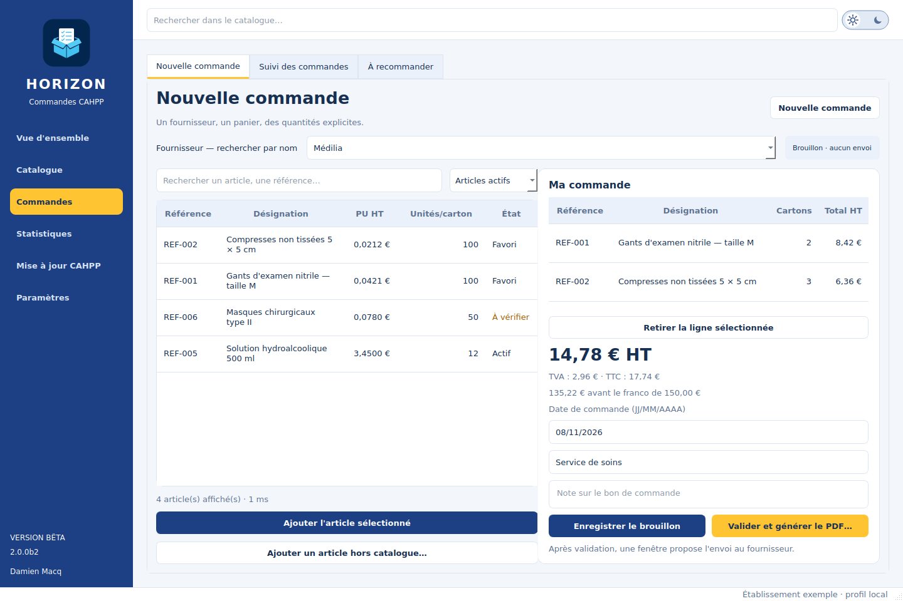

# Commandes CAHPP Horizon

**Branche expérimentale `feature/horizon-ui` — alpha 2.0.0a9.**
Interface Qt aux couleurs LADAPT, développée en parallèle de la version stable.
Après validation du PDF, une fenêtre propose l'envoi au fournisseur et sa
confirmation sans quitter la commande. Les fiches fournisseurs sont regroupées
dans **Paramètres → Fournisseurs**.
Le menu **Commandes** regroupe la préparation, le suivi et les recommandations.
L'onglet **Paramètres → À propos** présente l'auteur Damien Macq et les crédits.

- [Lancement, fonctions et limites d'Horizon](docs/horizon.md)
- Windows : `horizon_windows.bat` pour lancer les sources ;
  `horizon_windows.bat build` pour fabriquer le dossier portable.
- Linux x86_64 : **AppImage** autonome, sans installation de Python ;
  `bash build_horizon_linux.sh` pour le construire depuis les sources.
- [Builds Windows/Linux et contrôles automatiques](https://github.com/omg59/commandes-cahpp/actions/workflows/horizon.yml) :
  ouvrir le dernier run réussi de la branche `feature/horizon-ui`, puis choisir
  **Artifacts** → **CommandesCAHPP-Horizon-Linux-x86_64**, **CommandesCAHPP-Horizon-Windows**
  ou **CommandesCAHPP-Horizon-Installer-Windows**. Il faut être connecté à GitHub
  pour télécharger ces artefacts.

Horizon crée un profil de démonstration séparé. Dans **Paramètres → Maintenance**,
le bouton **Copier une base 1.6…**
ouvre une copie indépendante de la base et des documents accessibles.
Les fonctions métier de la 1.6.0 sont reprises : réglages, fournisseurs,
réceptions, documents, e-mails, recommandations, statistiques, collaboration et
diagnostics complets. Le partage est activé explicitement dans les paramètres
du profil Horizon. `build_horizon_installer.bat` prépare son installateur séparé.
La validation Windows et du partage de l'établissement précède son usage quotidien.



## Documentation du moteur et de la version stable

Application Windows locale pour importer un catalogue tarifaire CAHPP, retrouver
rapidement les articles, préparer des commandes fournisseurs et générer des bons
de commande PDF. Le mode collaboratif optionnel permet à plusieurs postes de
travailler ensemble à travers un simple dossier partagé, sans serveur.

**Version : 1.6.0**

## Documentation

- [Historique des versions](CHANGELOG.md)
- [Guide du mode collaboratif](docs/collaboration.md)
- [Tests et checklist de validation](docs/validation.md)
- [Développement et publication](docs/developpement.md)

## Principes

- application, catalogue et base SQLite conservés localement sur chaque poste ;
- aucun serveur, compte en ligne ou droit administrateur nécessaire ;
- synchronisation optionnelle par fichiers versionnés dans un dossier partagé ;
- import des catalogues complets et des évolutions mensuelles CAHPP, avec
  détection du format et vérification de la chronologie ;
- sauvegarde automatique avant import et validation des conditionnements manquants ;
- conservation des tarifs historiques et des lignes de commandes déjà créées ;
- recherche par fournisseur, code CAHPP, référence ou désignation ;
- recherche catalogue non bloquante, avec annulation des saisies obsolètes ;
- recherche non bloquante et résultats progressifs dans **Nouvelle commande** ;
- contrôle et réparation automatiques de l'index plein texte FTS5 ;
- affichage progressif des résultats par pages de 100 articles ;
- tri des tableaux par clic sur les titres de colonnes ;
- favoris et quantités habituelles ;
- duplication des commandes récurrentes ;
- reprise d'une commande générée ou avec e-mail préparé, avant son envoi,
  en conservant son numéro ;
- avertissement avant de quitter avec des saisies non enregistrées ;
- suppression des commandes non envoyées, même après génération du PDF ou
  préparation d'un e-mail, avec propagation aux autres postes ;
- recherche dans tout l'historique, y compris les références et désignations ;
- suivi des commandes envoyées restant à livrer ;
- confirmations fournisseur et dates de livraison prévues ;
- réceptions partielles avec plusieurs bons de livraison et calcul des reliquats ;
- suivi de la facturation et notes internes partagées sur chaque commande ;
- statistiques par période, fournisseur et produit ;
- archivage configurable des anciennes commandes livrées ;
- rappel de sauvegarde et contrôle périodique de l'intégrité SQLite ;
- notification lorsqu'un nouvel installeur est déposé dans le partage ;
- lancement direct de l'installateur partagé avec fermeture propre de l'application ;
- alertes configurables sur les confirmations manquantes et livraisons en retard ;
- suggestions d'articles à recommander selon leur rythme historique ;
- filtres d'historique enregistrés et recommandation sélective d'articles ;
- indicateurs de délai fournisseur, comparaison des prix et export Excel ;
- notes internes et références de remplacement dans le catalogue ;
- service ou unité destinataire mémorisé sur la commande et imprimé sur le PDF ;
- suivi des changements de prix et de conditionnement des articles commandés ;
- rattachement des bons de livraison et autres documents ;
- préparation des e-mails sans mot de passe ni droit administrateur ;
- sauvegarde complète de la base et des documents liés ;
- bon PDF commun à tous les fournisseurs.

## Collaboration sans serveur

Le mode collaboratif ne place jamais la base SQLite sur le réseau. Chaque utilisateur
installe son propre dossier `CommandesCAHPP-portable` sur son PC. Seul le dossier
choisi dans **Paramètres > Collaboration** doit être commun aux utilisateurs.

Ce mode synchronise :

- les commandes, leur statut, leur PDF et leurs documents liés ;
- les fournisseurs, favoris et quantités habituelles ;
- les corrections manuelles des articles CAHPP ;
- les articles hors catalogue, y compris leur modification ou archivage ;
- les paramètres communs de l'établissement, du PDF et des modèles d'e-mail ;
- la version du catalogue CAHPP publiée par un utilisateur.

Un numéro de commande est réservé de manière commune. Une commande ou un article
en cours de modification est temporairement verrouillé au nom de l'utilisateur.
Les autres commandes restent utilisables en parallèle.

La synchronisation s'effectue au démarrage, selon le délai choisi, après les
actions importantes et à la demande. Le délai automatique est configurable
dans **Paramètres > Collaboration**, de 15 secondes à 10 minutes.

Par défaut, la synchronisation automatique se met en pause dès que la fiche
établissement ou une fiche fournisseur contient une saisie non enregistrée.
Le formulaire affiché est également protégé contre un rafraîchissement déjà en
cours. L'enregistrement déclenche ensuite immédiatement la synchronisation.

Les PDF et documents reçus sont aussi mis en cache localement. Si le réseau
disparaît, l'historique reste consultable ; les modifications nécessitant un
verrou sont bloquées jusqu'au retour du partage afin d'éviter les conflits.

## Confort d'utilisation

La section actuellement ouverte reste mise en évidence dans la barre latérale.
Le numéro de version du logiciel est affiché en bas de cette barre.
Après un enregistrement réussi, le bouton concerné passe temporairement au vert
et confirme l'action sans ouvrir de fenêtre supplémentaire.

Les fenêtres restent utilisées lorsqu'une décision, une erreur, un
avertissement ou un bilan détaillé nécessite l'attention de l'utilisateur.

## Lancement depuis les sources

Python 3.11 ou 3.12 est recommandé.

```bat
py -3.12 -m venv .venv
.venv\Scripts\python.exe -m pip install -r requirements.txt
.venv\Scripts\python.exe main.py
```

## Création du dossier portable Windows

Depuis un poste Windows 11 64 bits :

```bat
build_windows.bat
```

Le résultat se trouve dans `dist\CommandesCAHPP-portable`. Copiez séparément ce
dossier sur chaque poste. Les données de chaque utilisateur restent dans
`data\commandes_cahpp.sqlite3`, à côté de son application. Le script de
compilation ne copie aucune base de développement.

## Création de l'installeur Windows

Pour obtenir un seul fichier `.exe` d'installation et de mise à jour, installez
une fois [Inno Setup 6 ou 7](https://jrsoftware.org/isinfo.php) sur le PC Windows qui
sert à compiler, puis lancez :

```bat
build_installer_windows.bat
```

Le fichier obtenu se trouve dans :

```text
dist-installer\CommandesCAHPP-Setup-1.6.0.exe
```

Le script détecte Inno Setup dans le `PATH`, dans `Program Files`, dans
`%LOCALAPPDATA%\Programs\Inno Setup 6`, ainsi que dans les emplacements WinGet,
Scoop et les entrées de registre habituelles. Une installation limitée au
compte utilisateur est donc prise en charge.

Pour préparer une version à diffuser, utiliser **`build_release.bat`** : il
contrôle les numéros de version, lance Ruff et les tests avec interface, puis
construit l'installateur et ses fichiers de contrôle SHA-256 et JSON dans
`dist-installer`. Tout échec interrompt cette préparation. Il reste nécessaire
de tester l'installation, la mise à jour et le lancement de l'EXE sur Windows.

L'installeur fonctionne sans droit administrateur. Il remplace uniquement
`CommandesCAHPP.exe` et `_internal` ; il conserve la base `data`, les documents,
le logo et les autres fichiers utilisateur. Lors de la première mise à jour
d'une installation portable existante, choisissez son dossier actuel. Les
mises à jour suivantes réutiliseront automatiquement ce dossier.

Il ne s'agit pas d'une mise à jour téléchargée depuis Internet : l'EXE est
placé volontairement dans le dossier partagé par l'utilisateur qui prépare la
version.

En mode collaboratif, le sous-dossier `mises-a-jour` est créé automatiquement
dans l'espace partagé. Un installeur nommé
`CommandesCAHPP-Setup-X.Y.Z.exe` qui y est déposé déclenche une notification
sur les postes utilisant une version antérieure. L'utilisateur peut lancer
l'installation directement ; l'application ferme alors proprement ses verrous
et laisse l'installateur remplacer uniquement les fichiers du programme.

## Première utilisation

1. Au premier lancement, renseigner le nom qui apparaîtra dans l'historique.
2. Si plusieurs postes sont utilisés, choisir le même dossier dans
   **Paramètres > Collaboration** sur chacun d'eux.
3. Ouvrir **Paramètres** et renseigner l'établissement.
4. Sur un seul poste, ouvrir **Mise à jour CAHPP** et sélectionner le fichier
   Excel du catalogue à utiliser. Il sera proposé aux autres postes.
5. Configurer les fournisseurs utilisés : numéro client, adresse e-mail et
   montant du franco.
6. Marquer les articles habituels comme favoris.
7. Préparer une commande et générer le PDF.

Le guide détaillé du [mode collaboratif](docs/collaboration.md)
explique l'installation à deux postes et les comportements en cas de coupure.

## Diagnostic et assistance

Depuis la 1.5.2, les statistiques utilisées par SQLite pour choisir son parcours
de recherche sont actualisées au premier contrôle ou à la première recherche,
puis après un nouvel import ou une reconstruction. Ce traitement se déroule
dans le worker ; il n'est pas répété à chaque frappe. La requête consulte
d'abord les correspondances FTS5, puis les fiches produits par identifiant.

Si l'index est indiqué **OK** mais que des recherches dépassent le délai
autorisé, une nouvelle reconstruction ne suffit pas forcément. Le diagnostic
inclut désormais le résultat de l'actualisation des statistiques et le plan
d'une requête témoin, sans enregistrer les recherches saisies. La limite de
temps et l'annulation des recherches obsolètes restent actives.

Si la recherche signale un index indisponible, ouvrir **Paramètres → Collaboration
→ Diagnostic**, puis cliquer sur **Reconstruire l'index**. Attendre la fin de
l'opération : elle s'exécute en arrière-plan. Le logiciel recrée uniquement
l'index local à partir des articles présents, vérifie son intégrité FTS5 et
teste une recherche avec classement avant de confirmer la réussite.

Les commandes, les fournisseurs, les corrections d'articles et le dossier
partagé ne sont pas modifiés par cette reconstruction. Relancer ensuite la
recherche dans le catalogue. En cas d'échec, utiliser **Exporter le rapport**
avant de fermer l'application : il contient le résultat de la dernière
reconstruction de cette session, sa durée et la catégorie d'erreur SQLite.
Le bouton reste disponible pour réessayer après correction du problème.

La réparation automatique attend 30 secondes avant de réessayer après un
échec, pour éviter de reconstruire à chaque frappe. Le bouton manuel permet
de réessayer immédiatement. Si la recherche dépasse son délai autorisé,
le message le précise sans conclure à un index endommagé.

Le bouton **Diagnostic** de l'onglet **Collaboration** contrôle :

- l'intégrité de la base SQLite locale ;
- la version du schéma et le fonctionnement de la recherche ;
- les commandes restant à synchroniser ;
- l'accès en lecture et en écriture au dossier partagé ;
- la cohérence de l'identifiant collaboratif ;
- la présence et l'intégrité du catalogue partagé ;
- les verrous collaboratifs encore actifs ou expirés.

Le rapport peut être copié ou enregistré au format texte. Il contient les
chemins techniques, la version et le nom du profil, mais aucun tarif, article,
contenu de commande ou document. Il peut donc être transmis pour analyser un
problème sans exposer les données métier.

Avant de considérer la version comme validée, suivre
la [checklist de validation commune](docs/validation.md) sur les deux postes.

La liste des fournisseurs de l'écran **Nouvelle commande** est filtrée pendant
la saisie du nom. Depuis **Catalogue**, sélectionner un article puis cliquer sur
**Commander cet article** pour ouvrir directement une commande avec le bon
fournisseur.

Les favoris du fournisseur sont affichés en premier dans la préparation d'une
commande. En l'absence de recherche, la liste est limitée aux favoris s'il en
existe.

## Corriger et gérer les articles

Dans **Catalogue**, le bouton **Modifier l'article** permet de corriger la
référence fournisseur, la désignation, le conditionnement, son détail, le prix
et la TVA.

Pour un article CAHPP, la correction est enregistrée séparément de la valeur
importée. Elle reste active après les imports suivants. La mention `CAHPP ✎`
signale une correction et **Rétablir CAHPP** supprime les corrections locales.

Les références créées avec **Article hors catalogue** sont identifiées par
`Local`. Elles peuvent être modifiées ou supprimées. La suppression les archive
sans modifier les anciennes commandes.

## Personnalisation du PDF

Dans **Paramètres**, il est possible de modifier :

- le nom, l'adresse et les identifiants de l'établissement ;
- le logo ;
- le titre du document ;
- le texte du pied de page, qui peut rester vide ;
- l'affichage du numéro de page ;
- le dossier proposé par défaut lors de l'enregistrement.

Pour un logo portable, placez-le par exemple dans `assets\logo.png` puis
indiquez simplement `assets/logo.png` dans les paramètres.

Lors de chaque génération ou régénération, une fenêtre **Enregistrer sous**
permet de modifier librement le nom et la destination du PDF.
Le PDF contient uniquement la référence utile au fournisseur ; le code interne
CAHPP n'y est pas affiché.

Le nom proposé suit le format :

```text
BC-AAAA-MM-JJ_Fournisseur.pdf
```

S'il existe plusieurs commandes le même jour pour le même fournisseur, le
compteur est ajouté automatiquement :

```text
BC-2026-07-28_Hartmann.pdf
BC-2026-07-28_2_Hartmann.pdf
BC-2026-07-28_3_Hartmann.pdf
```

## Reprendre une commande avant envoi

1. Ouvrir **Historique**.
2. Sélectionner une commande **Brouillon**, **Générée** ou **E-mail préparé**
   qui n'a pas encore été envoyée.
3. Cliquer sur **Reprendre / corriger** ou double-cliquer sur la ligne ;
   confirmer la reprise si le PDF ou l'e-mail a déjà été préparé.
4. Modifier les articles, quantités ou la note.
5. Enregistrer à nouveau le brouillon ou générer le PDF.

La commande redevient un brouillon avec le même numéro, la même date, ses
pièces jointes et son journal. La référence au PDF et la préparation d'e-mail
sont invalidées : régénérer le PDF après correction. Les copies déjà exportées
restent sur le disque ; supprimer soi-même tout brouillon ouvert dans la
messagerie et remplacer ses pièces jointes avant l'envoi.

Une commande marquée envoyée, confirmée, réceptionnée ou facturée ne peut pas
être reprise. En mode collaboratif, un verrou réserve la commande au poste
qui la corrige et le retour au statut brouillon est synchronisé.

Pour repartir d'une ancienne commande, sélectionnez-la dans **Historique** puis
cliquez sur **Dupliquer**. Un nouveau brouillon daté du jour est créé avec les
prix et conditionnements de la commande d'origine.

Une commande non envoyée devenue inutile peut être retirée avec **Supprimer**.
L'application demande une confirmation et, en mode collaboratif, vérifie
d'abord que le brouillon n'est pas ouvert sur un autre poste. La suppression
est ensuite synchronisée et le brouillon ne réapparaît pas lorsqu'un poste
resté hors ligne se reconnecte. Cela reste possible après génération du PDF
ou préparation d'un e-mail. Les commandes envoyées ou déjà suivies ne sont
pas supprimables afin de préserver la traçabilité.

L'historique affiche la date de création, le créateur, l'état de
synchronisation et la première date d'envoi. Cette dernière est renseignée avec
**Marquer envoyée**. La date propre au bon reste conservée dans la base et
utilisée dans le PDF et son nom de fichier. Le bouton **Journal** détaille les
actions nominatives de la commande.

## Préparer une commande par e-mail

Dans **Fournisseurs**, renseignez l'adresse e-mail de commande. L'adresse de
composition, l'objet et le message peuvent être modifiés dans **Paramètres**.
La liste des expressions disponibles y est affichée :

```text
{order_number} {date} {order_date} {supplier} {supplier_email}
{customer_number} {total_ht} {total_ttc}
{establishment_name} {establishment_subtitle}
```

`{date}` correspond à la date du bon au format `JJ/MM/AAAA`, tandis que
`{order_date}` conserve le format `AAAA-MM-JJ`.

Dans **Historique**, le bouton **Préparer le mail** :

1. ouvre un message avec le destinataire, l'objet et le texte préremplis ;
2. ouvre un dossier contenant le PDF et toutes les pièces marquées
   **Joint au mail** ;
3. permet de joindre l'ensemble par `Ctrl+A`, puis glisser-déposer.

Gmail reste configuré par défaut. Une URL de composition générique ou `mailto:`
peut également être utilisée. L'ajout final des pièces jointes reste manuel :
aucun identifiant ni mot de passe de messagerie n'est enregistré.

Lorsque la commande est marquée comme envoyée, son sous-dossier temporaire dans
`envois` est supprimé automatiquement. Le PDF original et les documents liés à
la commande sont conservés à leur emplacement habituel.

## Documents et bons de livraison

Dans **Historique**, sélectionnez une commande puis ouvrez
**Documents associés**. Les fichiers choisis sont copiés dans
`documents\<numero de commande>` à côté de l'application. En mode collaboratif,
une copie est publiée dans l'espace partagé puis mise en cache sur l'autre
poste. Ils restent ainsi liés à la commande même si le fichier original du
scanner est déplacé ou si le partage est temporairement indisponible.

**Ajouter un document…** permet de classer le fichier comme bon de livraison,
confirmation de commande, facture, devis, avoir, correspondance, pièce jointe
e-mail ou avec un type personnalisé. Les PDF, images, fichiers bureautiques,
messages `.eml`/`.msg`, textes et archives peuvent être conservés.

Le type du document et son inclusion au mail sont indépendants. Sélectionnez
une ligne puis cliquez sur **Type / mail…** pour modifier l'un ou l'autre après
l'ajout. Les bons de livraison ne sont pas joints au mail par défaut.

## Trier les articles

Dans **Catalogue** et **Nouvelle commande**, cliquez sur le titre d'une colonne
— référence, désignation, fournisseur, prix, conditionnement ou quantité — pour
trier le tableau. Un second clic inverse le sens du tri. La flèche `▲` ou `▼`
indique le classement actif, qui est conservé lors des recherches suivantes.

## Mise à jour des tarifs

Dans **Mise à jour CAHPP**, sélectionnez le fichier Excel fourni par CAHPP.
Le logiciel reconnaît les anciens catalogues complets et les nouveaux fichiers
**Evo TARIFS**, y compris les en-têtes comme `CODE_CAHPP`, `PRIXCAHPP`,
`ARTICLEACTIF` et `MOIS_MISEAJOUR`. Il affiche le format, le mois et le nombre
de lignes avant confirmation. Une sauvegarde complète est créée dans le
dossier local `sauvegardes` avant toute nouvelle application ; si elle échoue,
l'import est arrêté. Le compte rendu indique le nom de cette sauvegarde.

| Fichier | Comportement |
| --- | --- |
| Catalogue complet | Remplace les données CAHPP ; les références absentes deviennent inactives. Un retrait massif demande confirmation. |
| Évolutions mensuelles | Met à jour uniquement les références présentes ; conserve les autres et applique le statut explicite `ARTICLEACTIF`. |
| Catalogue partagé | Reprend un état complet du catalogue, même après plusieurs mois hors ligne ou sur un nouveau poste. |

Une évolution mensuelle ne suffit pas pour constituer une base complète.
Conservez votre catalogue existant. Lors du premier import mensuel, confirmez
que cette base contient bien les évolutions jusqu'au mois précédent : le
logiciel ne peut pas déduire sa période d'un ancien fichier. Ensuite, les mois
doivent se suivre ; un mois manquant ou un retour en arrière est refusé. Un
fichier différent pour le même mois demande confirmation de révision. Réimporter
un fichier identique n'applique pas ses changements une seconde fois.

Le fichier mensuel peut ne contenir ni `Conditionnement` ni `Qml`. Les quantités
connues sont conservées pour les références existantes. Les nouvelles références
sans colisage, les changements de conditionnement et les types d'évolution
inconnus sont signalés **à vérifier**. Le logiciel n'invente pas leur colisage à
partir de la désignation. Une TVA absente ou annoncée modifiée sans valeur
nécessite aussi vérification ; un prix absent reste manquant, sans devenir zéro.

Dans **Catalogue**, cochez **Articles à vérifier uniquement**, ouvrez
**Modifier l'article**, renseignez les valeurs vérifiées auprès du fournisseur
et cochez leur confirmation avant d'enregistrer. Ces articles restent bloqués
à la commande tant que la vérification n'est pas faite. Une nouvelle évolution
qui exige un contrôle invalide la confirmation précédente. Vérifiez aussi les
quantités d'un brouillon préparé avant un changement de conditionnement.

Les variations concernant des articles déjà commandés restent consultables
depuis l'historique des imports. Les anciennes commandes conservent leurs
valeurs d'origine. Les notes, favoris et corrections manuelles sont conservés.

En mode collaboratif, **mettez tous les postes en 1.6.0 ou supérieure avant
le premier import mensuel**. Un seul utilisateur importe le fichier ; le
logiciel diffuse ensuite un catalogue complet reconstitué, avec son empreinte
SHA-256, sa période et ses contrôles en attente. Les confirmations et corrections
sont synchronisées dans les données d'équipe. Voir le [guide](docs/collaboration.md).

## Seuils et conditionnements

Les coordonnées, le minimum de commande et le franco se configurent dans
**Fournisseurs**. Avant l'enregistrement, l'application avertit si :

- le nombre de cartons d'une ligne n'est pas entier ;
- le minimum de commande n'est pas atteint ;
- le franco n'est pas atteint.

L'utilisateur peut confirmer et continuer si le fournisseur accepte une
exception. Ces vérifications sont strictement internes : le PDF envoyé au
fournisseur ne mentionne jamais si le franco est atteint ou non.

## Sauvegarde complète

Le bouton **Exporter une sauvegarde complète**, dans l'onglet **Sauvegarde**
des paramètres, crée une archive ZIP contenant la base SQLite et tous les
documents locaux, y compris les copies mises en cache. Le dossier partagé
conserve par ailleurs les dernières révisions des commandes et des données
d'équipe ; il ne remplace pas une sauvegarde régulière.

## Mise à niveau depuis une ancienne version

Avec l'installeur V1.0, fermez l'application puis lancez le nouvel EXE en
conservant le même dossier d'installation. La base et les documents ne sont pas
remplacés. Une sauvegarde complète préalable reste conseillée.

Pour une mise à niveau manuelle, conservez votre fichier
`data\commandes_cahpp.sqlite3` et le dossier `documents`, puis remplacez
uniquement `CommandesCAHPP.exe` et `_internal`. L'application met
automatiquement la base à niveau au premier démarrage.

La 1.6.0 fait évoluer le schéma SQLite de 14 à 15 par ajout de champs, sans
recréation des commandes. Installez-la sur tous les postes avant de partager
les nouveaux catalogues mensuels. Elle inclut aussi les corrections de recherche
de la 1.5.2.

Ne placez ni l'exécutable ni `data\commandes_cahpp.sqlite3` dans le dossier
réseau ; configurez uniquement ce dernier depuis l'application.

## Compilation Windows

L'exécutable Windows doit être compilé sur Windows : PyInstaller ne permet pas
de produire de manière fiable un `.exe` Windows depuis Linux. Le script
`build_windows.bat` automatise entièrement cette compilation. L'application
obtenue fonctionne ensuite sans Python et sans connexion Internet. Le mode
collaboratif suppose seulement que Windows donne accès en lecture/écriture au
dossier réseau configuré.
