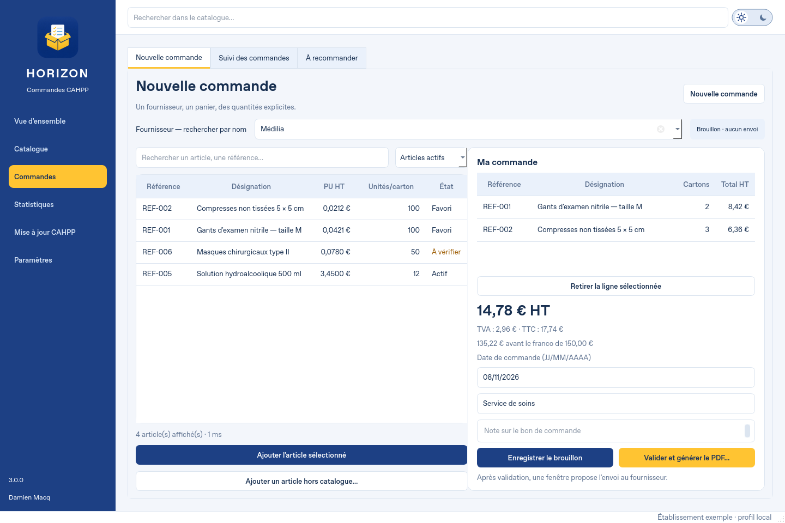

# Commandes CAHPP Horizon

**Windows et Linux · Version de test 2.1.0a3 · Réceptions Android**

Je développe Horizon pour simplifier la préparation et le suivi des commandes
fournisseurs à partir du catalogue CAHPP : retrouver les articles, préparer les
bons de commande et suivre les livraisons.

L’application fonctionne sous Windows et Linux, en local ou à plusieurs via un
dossier partagé, sans serveur dédié.

## Télécharger

| Système | Formats disponibles |
| --- | --- |
| **Windows 64 bits** | Installateur `.exe` ou version portable |
| **Linux x86_64** | **AppImage** ou archive portable |

Pour tester les réceptions Android, ouvrez le [workflow de ce dépôt](https://github.com/omg59/horizon-pc/actions/workflows/horizon.yml), puis **Artifacts**. Utilisez le dossier portable Windows ou l’AppImage Linux avec un profil de test. Les paquets incluent Python.

La [RC2 de Commandes CAHPP](https://github.com/omg59/commandes-cahpp/releases/tag/v2.0.0rc2) reste disponible dans son dépôt d’origine.

[Installation et prérequis détaillés →](docs/horizon.md)

## Au quotidien

- Catalogue CAHPP, recherche, favoris et fiches fournisseurs.
- Préparation des commandes, PDF et e-mail prérempli.
- Suivi des livraisons, documents, historique et statistiques.
- Import d’une base 1.6, sauvegardes et collaboration entre postes.

## Pour aller plus loin

[Guide utilisateur](docs/horizon.md) · [Collaboration](docs/collaboration.md) ·
[Documentation technique](docs/developpement.md) · [Validation](docs/validation.md) ·
[Historique des versions](CHANGELOG.md)

## Tester les réceptions Android

Utilisez une copie de profil et un dossier partagé de test. Dans **Paramètres → Collaboration**, activez le partage de test et enregistrez les paramètres. Dans **Paramètres → Android**, saisissez l’adresse HTTPS du relais et la **clé PC** configurée dans Portainer (`HORIZON_PC_TOKEN`). Cliquez sur **Enregistrer la connexion**, puis **Synchroniser avec Android**. Les commandes envoyées avec un reliquat deviennent disponibles sur le téléphone.

L’adresse est enregistrée dans le profil. Vous pouvez cocher **Mémoriser la clé dans le fichier local de ce profil** pour conserver également la clé entre deux démarrages. Cette option stocke la clé en clair dans `interface.ini`. Sans cette option, la clé saisie reste disponible pendant la session. Les variables d’environnement `HORIZON_RELAY_URL` et `HORIZON_PC_TOKEN` restent utilisables pour préremplir les champs. La clé mobile est distincte et se saisit sur Android.

Après l’envoi d’une réception depuis Android, cliquez de nouveau sur **Synchroniser avec Android**. La commande reçoit ses quantités et un seul bon de livraison PDF, dans l’ordre des photos. Le deuxième poste récupère le résultat par sa synchronisation habituelle avec le partage. Pour l’essai initial, utilisez la même version de test sur les deux postes. Le téléphone permet ensuite de vérifier l’archivage.
